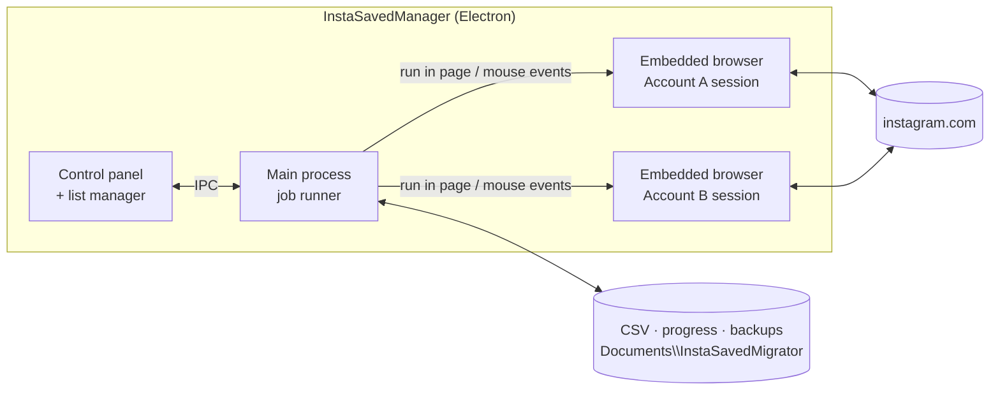
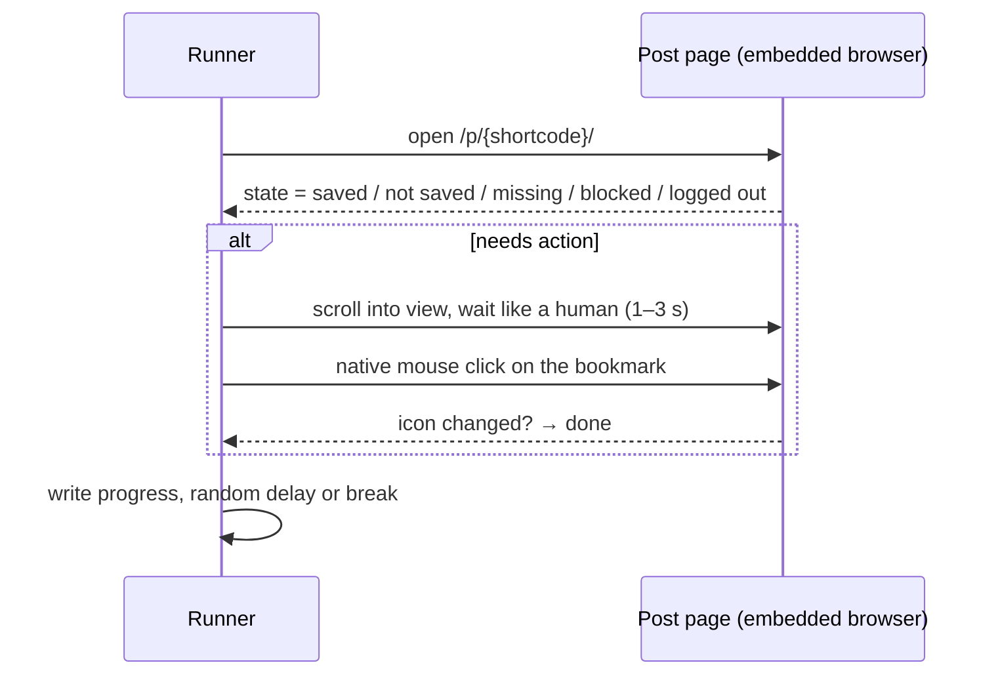

<div align="center">


# Instagram Saved — Transfer & Remove Manager

**Export, browse, bulk-unsave, and move your Instagram _Saved_ posts between accounts.**
A Windows desktop app with a built-in browser. You log in yourself, and the app does the repetitive clicking.

[](https://github.com/UniverseMaker/Instagram-Saved-Transfer-and-Remove-Manager/releases/latest)


[](LICENSE)

**English** · [한국어](README.ko.md)

[**⬇ Download the latest release**](https://github.com/UniverseMaker/Instagram-Saved-Transfer-and-Remove-Manager/releases/latest)

<picture>
  <source media="(prefers-color-scheme: dark)" srcset="docs/images/hero-dark.png" />
  
</picture>

<sub>All screenshots use generated demo data. The right-hand pane is a mock of the embedded browser, where the real app shows instagram.com.</sub>

</div>

---

## Table of contents

- [Goal](#-goal)
- [Why you might need this](#-why-you-might-need-this)
- [Features](#-features)
- [Download & install](#-download--install)
- [Quick start](#-quick-start)
- [The list manager](#-the-list-manager)
- [Speed, safety, and auto-stop](#-speed-safety-and-auto-stop)
- [How it works](#-how-it-works)
- [Files the app creates](#-files-the-app-creates)
- [Privacy](#-privacy)
- [Build from source](#-build-from-source)
- [Troubleshooting & FAQ](#-troubleshooting--faq)
- [Limitations & roadmap](#-limitations--roadmap)
- [Disclaimer](#-disclaimer)

---

## 🎯 Goal

Your Instagram **Saved** list can turn into a personal library: recipes, travel plans, design references, tutorials. It often holds hundreds or thousands of posts collected over years.

This project gives you **control over that library**:

1. **Own it.** Export everything to a CSV you can keep, search, and open in Excel.
2. **Move it.** Recreate the same Saved list on another account, in the original order.
3. **Clean it.** Unsave exactly the posts you choose, or all of them, with a backup made first.

The app does what you would do by hand (open a post, press the bookmark), only patiently, with progress tracking, resume support, and rate limits.

## 🤔 Why you might need this

Instagram has **no built-in way** to do any of the following:

| Situation | Without this tool | With this tool |
|---|---|---|
| Moving to a new account (new handle, separating personal and work, recovering from a lost account) | Open and re-save every post by hand, one at a time | Load the CSV and press **Save to this account**. It resumes where it stopped |
| Cleaning up thousands of saves | Unsave one by one in the app | Filter, select by row or range, then **Unsave selected**, or use **Unsave all…** |
| Keeping an offline record of what you saved | "Download your information" gives a static archive that can't be restored to an account | A clean CSV (shortcode, URL, author, caption, collections) that can also be **restored** |
| Choosing only some saves to move | Not possible | Browse thumbnails, select, and save them to the other account |
| Doing all of the above safely | Fast manual tapping can trigger "Try Again Later" limits | Randomized delays, periodic breaks, per-run caps, and an automatic stop on a block |

## ✨ Features

### Two accounts side by side
Tabs **Account A** and **Account B** each use an isolated browser session, so you can stay logged in to both at the same time. Every action runs against the account in the selected tab. Login happens on Instagram's own page inside the app, so 2-factor authentication and other checks work as usual.

### Export to CSV
One click collects your entire Saved list page by page and writes a UTF-8 CSV that opens in Excel without broken characters. The file is rewritten after every page, so an interruption never loses what was already fetched. Collection names are included.

### List manager
A full-window thumbnail grid of your saves with search, filters, sorting, and several ways to select. [More below](#-the-list-manager).

### Unsave: selected or everything
- **Selected:** pick posts in the list manager and unsave them from any logged-in account.
- **Unsave all…:** fetches the complete list, **writes a backup CSV first**, shows you the count, asks again, and only then starts.

### Restore / migrate to another account
Opens each post on the target account and presses **Save**. By default it saves the **oldest first**, so the target account ends up in the same order as the original.

### Built for long jobs
- **Resume:** progress is stored next to the CSV. Run the same CSV again and finished items are skipped.
- **Result report:** a `*-result.csv` file lists the status of every post (`saved`, `already_saved`, `removed`, `not_saved`, `not_found`, `failed`, …).
- **Auto-stop** on rate limits, logout, identity checks, or 3 failures in a row.

<table>
<tr>
<td width="33%" align="center"><br/><sub><b>Restore in progress</b><br/>progress bar, counts, next-action countdown</sub></td>
<td width="33%" align="center"><br/><sub><b>Unsave all</b><br/>backup first, then unsave one by one</sub></td>
<td width="33%" align="center"><br/><sub><b>Speed / safety settings</b><br/>and an automatic stop on "Try Again Later"</sub></td>
</tr>
</table>

## ⬇ Download & install

Get the latest build from **[Releases](https://github.com/UniverseMaker/Instagram-Saved-Transfer-and-Remove-Manager/releases/latest)**:

| File | Use it when |
|---|---|
| `InstaSavedManager-x.y.z-portable.exe` | You want a single file with no installation. Double-click to run. Each launch unpacks to a temp folder first, so it starts a few seconds slower |
| `InstaSavedManager-x.y.z-setup.exe` | You'll use it regularly. It installs normally, adds Start-menu and desktop shortcuts, and starts faster |

> **Windows SmartScreen:** the executables are not code-signed, so the first launch may show "Windows protected your PC". Click **More info → Run anyway**. You can also [build it yourself](#-build-from-source) from this source.

Requirements: Windows 10 or 11 (x64). Nothing else is needed, because the browser is bundled.

> **UI language:** the interface is currently in **Korean**. This README explains every button, and the [screenshot captions](#-features) map the main screens.

## 🚀 Quick start

### 1. Back up your Saved list (export)

1. Select the **Account A** tab and log in on the Instagram page on the right.
2. Press **CSV로 내보내기** (_Export to CSV_) and choose where to save the file.
3. Wait for `✅ 내보내기 완료` (_export complete_) in the log.

### 2. Move saves from account A to account B

1. Export from **Account A** as above, or open the list manager, which writes a backup automatically.
2. Select the **Account B** tab and log in with the second account.
3. Under **CSV로 실행** (_Run from CSV_), press **CSV 불러오기** (_Load CSV_) and pick the file.
4. Press **이 계정에 저장 (복원)** (_Save to this account_).
5. Leave it running. You can stop at any time; loading the same CSV and pressing the button again continues where it left off.

> **Moving only some posts:** open **목록 관리** (_List manager_) on Account A, select posts, change **실행 계정** (_Run on account_) to Account B, and press **선택 항목 저장** (_Save selected_).

### 3. Clean up

- **Some posts:** open the list manager, filter and select, then press **선택 항목 저장 해제** (_Unsave selected_).
- **All posts:** press **전체 저장 해제…** (_Unsave all…_). A backup CSV is written before anything is removed. If you change your mind, restore it with workflow 2.

> 💡 **Test small first.** Set **한 번 실행 최대** (_Max per run_) to 3–5 in the settings and run once. Check the log, then raise the limit.

## 🗂 The list manager


| Action | How |
|---|---|
| Select one post | Click the card |
| Select a range | Click one card, then **Shift+click** another |
| **Select a whole row** | Click the **□** at the left of the row. It shows ✓ when the full row is selected and – when only part of it is |
| Select several rows | Click one row's □, then **Shift+click** another row's □ |
| Select everything visible | **Ctrl+A**, or **보이는 항목 모두 선택** (_Select all visible_) |
| Invert / clear | **선택 반전** (_Invert_) / **선택 해제** (_Clear_) |
| Open a post | Hover over a card → **열기 ↗** (_Open_) opens it in the embedded browser |
| Close the manager | **← 브라우저로** (_Back to browser_) or **Esc** |

The number of cards per row follows the window width. When you resize, the rows are recalculated and your selection stays as it was.


**Search and filters.** Free-text search covers the caption, @author, display name, and shortcode. Filters cover collection (including _no collection_) and type (photo / multiple images / video / reel). Sorting options are newest or oldest saved, newest or oldest posted, and author.


**Actions on the selection** (bottom bar), applied to the account chosen in **실행 계정** (_Run on account_):
- **선택 항목 저장 해제** (_Unsave selected_). A confirmation dialog appears first.
- **선택 항목 저장** (_Save selected_). This is how you move a selection to the other account.
- **선택 항목 CSV 저장** (_Export selected to CSV_)

Each selection run is written to `Documents\InstaSavedMigrator\jobs\…csv`, so you can resume it later with **CSV 불러오기** (_Load CSV_).


## 🛡 Speed, safety, and auto-stop

Instagram limits how fast an account can perform actions. This app is deliberately slow by default, and every value can be changed under **속도 / 안전 설정** (_Speed / safety_):

| Setting | Default | Meaning |
|---|---|---|
| Delay between actions | **15–40 s** (random) | Wait time after each successful save or unsave |
| Break every N actions | **40** | After N actions, take a longer break |
| Break length | **10 min** (±20%) | |
| Max per run | **200** | The run stops by itself after this many actions. Run the same CSV again later to continue |
| Oldest first (save) | **on** | Keeps the original order on the target account |
| Mode | **Click** | See below |

**It stops automatically when:**
- Instagram shows **"Try Again Later" / "Action Blocked"** → wait a few hours to a day and increase the delays
- the session is **logged out**, or a **checkpoint / identity check** appears → resolve it in the right-hand browser, then run again
- **3 failures in a row** → usually the page layout changed. Check the log

**Rough timing with the defaults:** about 27 s per action plus breaks, which is roughly 100 posts an hour. A few hundred per session is a sensible pace.

### Click mode vs API mode

| | **Click mode** (default, recommended) | **API mode** (experimental) |
|---|---|---|
| What it does | Opens `instagram.com/p/<code>/`, finds the bookmark button, and sends a real mouse click | Sends the save/unsave request directly without opening the post |
| Speed | Slower (page load + delay) | Faster |
| Robustness | Same thing a person does | Depends on a request address that Instagram can change |
| Fallback | — | If no working address is found, the run **switches to click mode by itself**. When a click succeeds, the app records the request Instagram actually sent and tries it in API mode next time |

## 🧩 How it works



- **Isolated sessions.** Each account tab is a separate Chromium session that persists on disk (`persist:` partitions), so both logins survive restarts.
- **Requests from inside the page.** Listing saved posts calls Instagram's web endpoints with `fetch` **inside the logged-in page**. The app never reads or stores your cookies or password.
- **Real clicks.** Click mode scrolls the bookmark button into view and sends native mouse events (`webContents.sendInputEvent`), then checks that the icon changed (Save ↔ Remove) before counting the post as done.
- **State machine per post.** Each post resolves to a final status. Progress is written after every item, so a crash or a stop never repeats work.



## 📁 Files the app creates

| Location | What |
|---|---|
| `Documents\InstaSavedMigrator\backup\saved_<account>_<time>.csv` | Written **every time** a list is loaded. This is your safety net |
| `Documents\InstaSavedMigrator\jobs\<save\|unsave>_<account>_<time>.csv` | The list of posts for a selection run. Load it again to resume |
| `<csv>.restore-progress.json` / `<csv>.unsave-progress.json` | Per-post progress used for resuming |
| `<csv>.restore-result.csv` / `<csv>.unsave-result.csv` | Final report with status, message, and time for each post |
| `%APPDATA%\insta-saved-migrator\` | Browser sessions (your logins) and remembered API addresses. **Log out** in the app to clear a session |

### CSV columns

| Column | Example | Notes |
|---|---|---|
| `saved_index` | `0` | 0 = most recently saved |
| `shortcode` | `C7xQ2mLp9aK` | The id in `instagram.com/p/<shortcode>/`. This column alone is enough to restore |
| `url` | `https://www.instagram.com/p/…/` | `/reel/…` for reels |
| `media_pk` | `3400…` | Numeric media id |
| `username`, `full_name` | `studio.lab`, `Studio Lab` | Author |
| `media_type`, `product_type` | `carousel`, `clips` | photo / video / carousel; `clips` = reel |
| `taken_at` | `2026-09-24T00:00:00.000Z` | Posted time (UTC) |
| `caption` | … | Full caption |
| `collection_ids`, `collection_names` | `…`, `여행\|레퍼런스` | `\|`-separated |
| `thumbnail_url` | … | Used by the list manager. Instagram image links expire after a while |

> A plain text file with **one post URL per line** also works as input.

## 🔒 Privacy

- **No servers, no telemetry, no analytics.** The app talks only to instagram.com, from the embedded browser, as you.
- **Your password never touches app code.** You type it into Instagram's own login page. The app only checks whether a session cookie exists to show "logged in".
- **Everything stays on your PC:** sessions in `%APPDATA%`, CSVs in `Documents`.
- The code is small and readable. Start with [`src/main.js`](src/main.js), [`src/runner.js`](src/runner.js), and [`src/saved.js`](src/saved.js).

## 🛠 Build from source

```bash
git clone https://github.com/UniverseMaker/Instagram-Saved-Transfer-and-Remove-Manager.git
cd Instagram-Saved-Transfer-and-Remove-Manager
npm install
npm start            # run in development
npm run dist         # build dist/*-portable.exe and dist/*-setup.exe
npm run screenshots  # regenerate the README images from demo data
```

If `npm install` reports that Electron's install script was not run (npm `allow-scripts`), run `npm approve-scripts electron`, or run `node node_modules/electron/install.js` once.

<details>
<summary><b>Project structure</b></summary>

```
src/
  main.js        Electron main: windows, sessions, IPC, jobs
  preload.js     Safe bridge between the UI and the main process
  ig.js          Runs fetch inside the Instagram page, delays, URL helpers
  saved.js       Saved-list paging → rows → CSV
  runner.js      Save/unsave runner: click & API modes, resume, auto-stop
  csv.js         Small CSV reader/writer (quotes, line breaks, BOM)
  ui/            Control panel + list manager (HTML/CSS/JS)
scripts/screenshots/  Demo-data screenshot generator for this README
build/           App icon
```
</details>

## ❓ Troubleshooting & FAQ

<details>
<summary><b>"저장 버튼을 찾지 못함" (<i>save button not found</i>)</b></summary>

The app finds the bookmark by its accessible label: `저장/삭제` (Korean), `Save/Remove` (English), or `保存/削除` (Japanese). If your Instagram UI uses another language, or Instagram renamed the button, the log line lists the labels it did find. Please open an issue with that line.
</details>

<details>
<summary><b>It stopped with "blocked" / "Try Again Later"</b></summary>

Instagram has limited the account for now. Wait several hours to a day, then increase the delays and lower **Max per run**. Progress is kept, so the next run continues where this one stopped.
</details>

<details>
<summary><b>API mode logs HTTP 404</b></summary>

The guessed address doesn't exist for your account or region. The run switches to click mode automatically. After the first successful click, check the log for `🔎`: it shows either the address that was recorded or the kind of request Instagram used.
</details>

<details>
<summary><b>Many posts end as <code>not_found</code></b></summary>

The post was deleted, the author's account is private (and the target account doesn't follow it), or the author blocked the account. These can't be saved and are skipped.
</details>

<details>
<summary><b>Is the order preserved?</b></summary>

Yes, when **오래된 것부터** (_Oldest first_) is on (the default), posts are saved oldest first, so the newest ends up on top just like the original account.
</details>

<details>
<summary><b>Are collections recreated on the target account?</b></summary>

Not yet. Collection names are recorded in the CSV, and you can filter by them in the list manager, but restore saves posts to the main Saved list only. See the roadmap.
</details>

<details>
<summary><b>Does it work on macOS / Linux?</b></summary>

The code is cross-platform Electron, but only Windows builds are published. `npm start` should work on other systems. Packaging for them is on the roadmap.
</details>

## 🗺 Limitations & roadmap

- [x] Export · list manager · selective/all unsave · migration · resume · auto-stop
- [x] Row selection, range selection, filters
- [ ] Recreate **collections** on the target account
- [ ] **Move** mode: save to B and unsave from A in one pass
- [ ] English UI
- [ ] macOS / Linux builds, code-signed Windows build

Ideas and bug reports are welcome in [Issues](https://github.com/UniverseMaker/Instagram-Saved-Transfer-and-Remove-Manager/issues).

## ⚠ Disclaimer

This is an independent open-source project. It is **not affiliated with, endorsed by, or sponsored by Instagram or Meta**. "Instagram" is a trademark of its owner.

Automating actions may go against Instagram's Terms of Use and can lead to temporary limits on your account. The app only acts on **your own** accounts, at a deliberately slow pace, and stops when Instagram pushes back. Even so, **you use it at your own risk**. Keep the backup CSVs.

## 📄 License

[MIT](LICENSE) © 2026 UniverseMaker
