<div align="center">


# Instagram Saved — Transfer & Remove Manager

**Export, browse, bulk-unsave, and move your Instagram _Saved_ posts between accounts.**
A Windows desktop app with a built-in browser. You log in yourself, and the app does the repetitive clicking.

**인스타그램 _저장됨_ 게시물을 내보내고, 둘러보고, 한꺼번에 해제하고, 다른 계정으로 옮깁니다.**
브라우저가 내장된 Windows 데스크톱 앱입니다. 로그인은 직접 하고, 반복 클릭은 앱이 대신합니다.

[](https://github.com/UniverseMaker/Instagram-Saved-Transfer-and-Remove-Manager/releases/latest)


[](LICENSE)

**[English](#english)** · **[한국어](#한국어)**

[**⬇ Download the latest release**](https://github.com/UniverseMaker/Instagram-Saved-Transfer-and-Remove-Manager/releases/latest)

<picture>
  <source media="(prefers-color-scheme: dark)" srcset="docs/images/hero-dark.png" />
  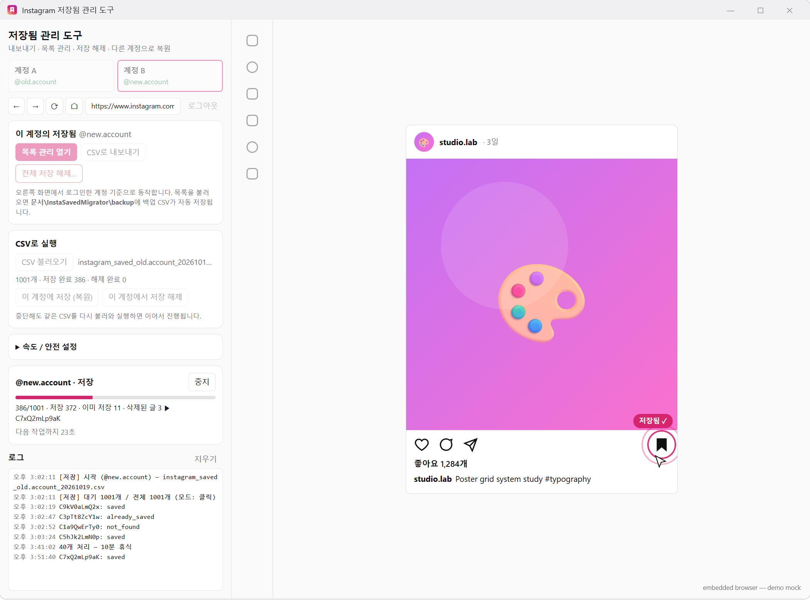
</picture>

<sub>All screenshots use generated demo data. The right-hand pane is a mock of the embedded browser. · 모든 스크린샷은 데모 데이터이며, 오른쪽 영역은 내장 브라우저 목업입니다.</sub>

</div>

# English

## Table of contents

- [Goal](#-goal)
- [Why you might need this](#-why-you-might-need-this)
- [Features](#-features)
- [Download & install](#-download--install)
- [Quick start](#-quick-start)
- [The list manager](#-the-list-manager)
- [Speed, safety, and auto-stop](#-speed-safety-and-auto-stop)
- [How it works](#-how-it-works)
- [Files the app creates](#-files-the-app-creates)
- [Privacy](#-privacy)
- [Build from source](#-build-from-source)
- [Troubleshooting & FAQ](#-troubleshooting--faq)
- [Limitations & roadmap](#-limitations--roadmap)
- [Disclaimer](#-disclaimer)
- **[🇰🇷 한국어로 읽기 →](#한국어)**

---

## 🎯 Goal

Your Instagram **Saved** list can turn into a personal library: recipes, travel plans, design references, tutorials. It often holds hundreds or thousands of posts collected over years.

This project gives you **control over that library**:

1. **Own it.** Export everything to a CSV you can keep, search, and open in Excel.
2. **Move it.** Recreate the same Saved list on another account, in the original order.
3. **Clean it.** Unsave exactly the posts you choose, or all of them, with a backup made first.

The app does what you would do by hand (open a post, press the bookmark), only patiently, with progress tracking, resume support, and rate limits.

## 🤔 Why you might need this

Instagram has **no built-in way** to do any of the following:

| Situation | Without this tool | With this tool |
|---|---|---|
| Moving to a new account (new handle, separating personal and work, recovering from a lost account) | Open and re-save every post by hand, one at a time | Load the CSV and press **Save to this account**. It resumes where it stopped |
| Cleaning up thousands of saves | Unsave one by one in the app | Filter, select by row or range, then **Unsave selected**, or use **Unsave all…** |
| Keeping an offline record of what you saved | "Download your information" gives a static archive that can't be restored to an account | A clean CSV (shortcode, URL, author, caption, collections) that can also be **restored** |
| Choosing only some saves to move | Not possible | Browse thumbnails, select, and save them to the other account |
| Doing all of the above safely | Fast manual tapping can trigger "Try Again Later" limits | Randomized delays, periodic breaks, per-run caps, and an automatic stop on a block |

## ✨ Features

### Two accounts side by side
Tabs **Account A** and **Account B** each use an isolated browser session, so you can stay logged in to both at the same time. Every action runs against the account in the selected tab. Login happens on Instagram's own page inside the app, so 2-factor authentication and other checks work as usual.

### Export to CSV
One click collects your entire Saved list page by page and writes a UTF-8 CSV that opens in Excel without broken characters. The file is rewritten after every page, so an interruption never loses what was already fetched. Collection names are included.

### List manager
A full-window thumbnail grid of your saves with search, filters, sorting, and several ways to select. [More below](#-the-list-manager).

### Unsave: selected or everything
- **Selected:** pick posts in the list manager and unsave them from any logged-in account.
- **Unsave all…:** fetches the complete list, **writes a backup CSV first**, shows you the count, asks again, and only then starts.

### Restore / migrate to another account
Opens each post on the target account and presses **Save**. By default it saves the **oldest first**, so the target account ends up in the same order as the original.

### Built for long jobs
- **Resume:** progress is stored next to the CSV. Run the same CSV again and finished items are skipped.
- **Result report:** a `*-result.csv` file lists the status of every post (`saved`, `already_saved`, `removed`, `not_saved`, `not_found`, `failed`, …).
- **Auto-stop** on rate limits, logout, identity checks, or 3 failures in a row.

<table>
<tr>
<td width="33%" align="center">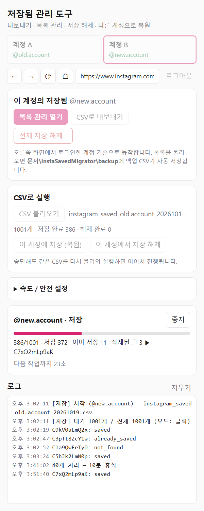<br/><sub><b>Restore in progress</b><br/>progress bar, counts, next-action countdown</sub></td>
<td width="33%" align="center">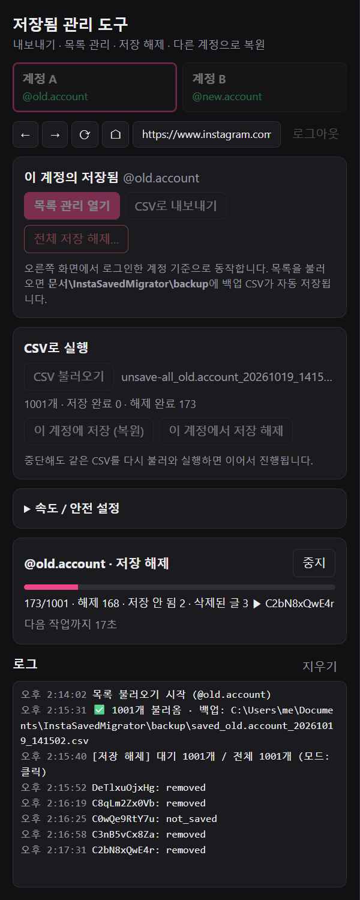<br/><sub><b>Unsave all</b><br/>backup first, then unsave one by one</sub></td>
<td width="33%" align="center">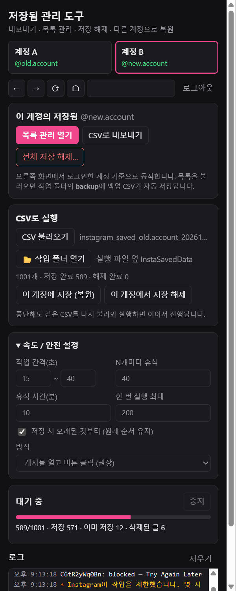<br/><sub><b>Speed / safety settings</b><br/>and an automatic stop on "Try Again Later"</sub></td>
</tr>
</table>

## ⬇ Download & install

Get the latest build from **[Releases](https://github.com/UniverseMaker/Instagram-Saved-Transfer-and-Remove-Manager/releases/latest)**:

| File | Use it when |
|---|---|
| `InstaSavedManager-x.y.z-portable.exe` | You want a single file with no installation. Double-click to run. Each launch unpacks to a temp folder first, so it starts a few seconds slower |
| `InstaSavedManager-x.y.z-setup.exe` | You'll use it regularly. It installs normally, adds Start-menu and desktop shortcuts, and starts faster |

> **Windows SmartScreen:** the executables are not code-signed, so the first launch may show "Windows protected your PC". Click **More info → Run anyway**. You can also [build it yourself](#-build-from-source) from this source.

Requirements: Windows 10 or 11 (x64). Nothing else is needed, because the browser is bundled.

> **UI language:** the interface is currently in **Korean**. This README explains every button, and the [screenshot captions](#-features) map the main screens.

## 🚀 Quick start

### 1. Back up your Saved list (export)

1. Select the **Account A** tab and log in on the Instagram page on the right.
2. Press **CSV로 내보내기** (_Export to CSV_) and choose where to save the file.
3. Wait for `✅ 내보내기 완료` (_export complete_) in the log.

### 2. Move saves from account A to account B

1. Export from **Account A** as above, or open the list manager, which writes a backup automatically.
2. Select the **Account B** tab and log in with the second account.
3. Under **CSV로 실행** (_Run from CSV_), press **CSV 불러오기** (_Load CSV_) and pick the file.
4. Press **이 계정에 저장 (복원)** (_Save to this account_).
5. Leave it running. You can stop at any time; loading the same CSV and pressing the button again continues where it left off.

> **Moving only some posts:** open **목록 관리** (_List manager_) on Account A, select posts, change **실행 계정** (_Run on account_) to Account B, and press **선택 항목 저장** (_Save selected_).

### 3. Clean up

- **Some posts:** open the list manager, filter and select, then press **선택 항목 저장 해제** (_Unsave selected_).
- **All posts:** press **전체 저장 해제…** (_Unsave all…_). A backup CSV is written before anything is removed. If you change your mind, restore it with workflow 2.

> 💡 **Test small first.** Set **한 번 실행 최대** (_Max per run_) to 3–5 in the settings and run once. Check the log, then raise the limit.

## 🗂 The list manager

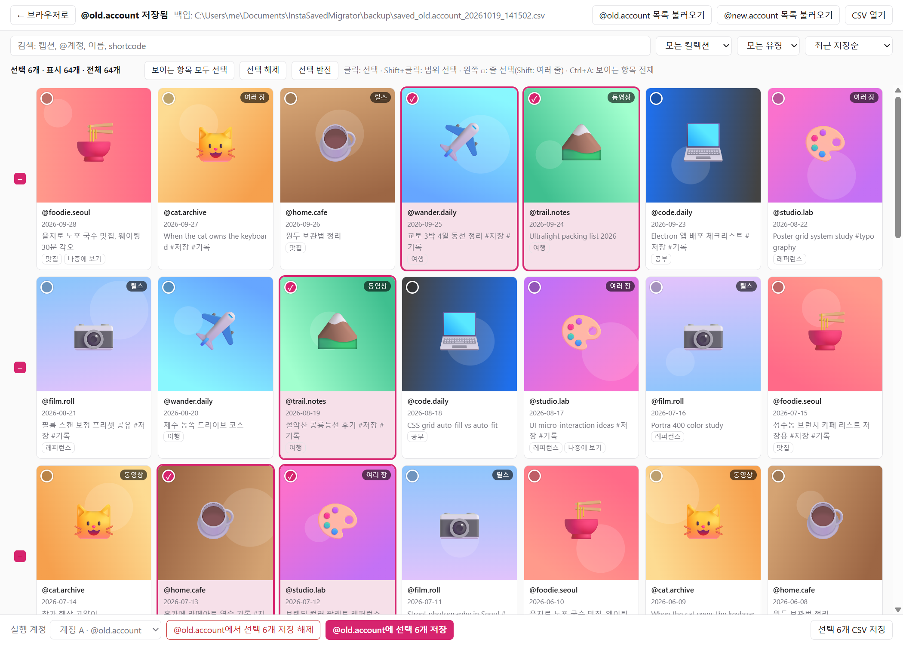

| Action | How |
|---|---|
| Select one post | Click the card |
| Select a range | Click one card, then **Shift+click** another |
| **Select a whole row** | Click the **□** at the left of the row. It shows ✓ when the full row is selected and – when only part of it is |
| Select several rows | Click one row's □, then **Shift+click** another row's □ |
| Select everything visible | **Ctrl+A**, or **보이는 항목 모두 선택** (_Select all visible_) |
| Invert / clear | **선택 반전** (_Invert_) / **선택 해제** (_Clear_) |
| Open a post | Hover over a card → **열기 ↗** (_Open_) opens it in the embedded browser |
| Close the manager | **← 브라우저로** (_Back to browser_) or **Esc** |

The number of cards per row follows the window width. When you resize, the rows are recalculated and your selection stays as it was.

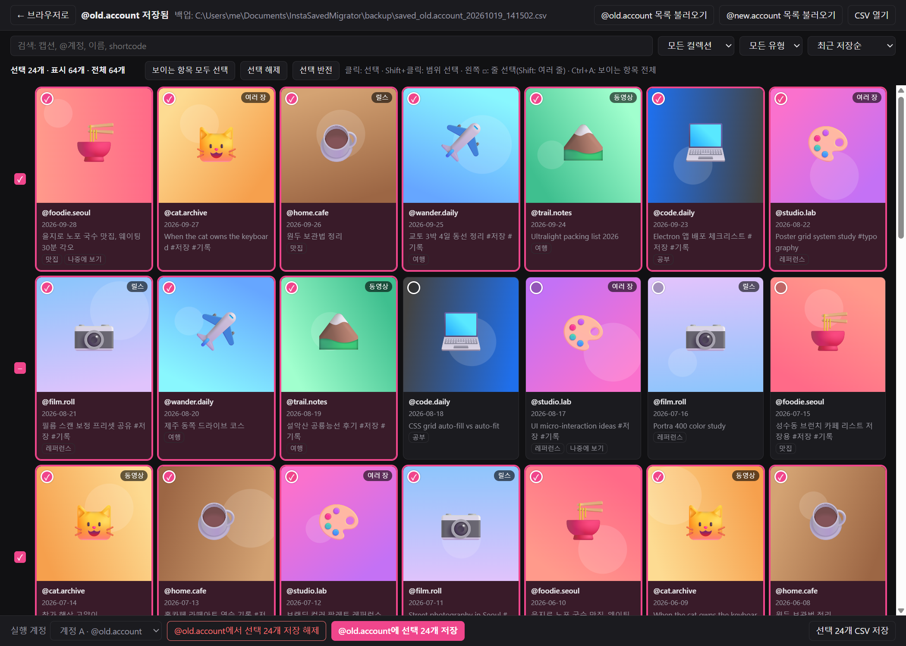

**Search and filters.** Free-text search covers the caption, @author, display name, and shortcode. Filters cover collection (including _no collection_) and type (photo / multiple images / video / reel). Sorting options are newest or oldest saved, newest or oldest posted, and author.

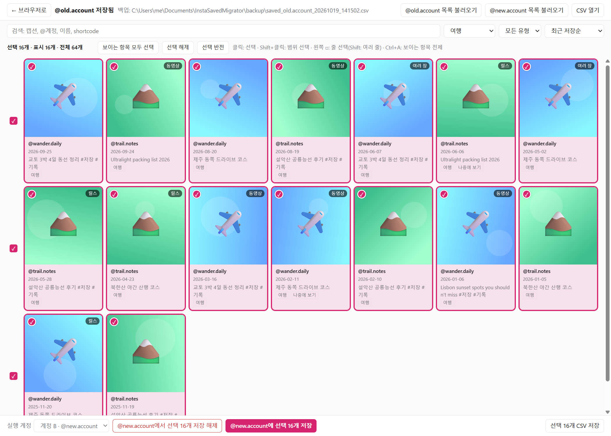

**Actions on the selection** (bottom bar), applied to the account chosen in **실행 계정** (_Run on account_):
- **선택 항목 저장 해제** (_Unsave selected_). A confirmation dialog appears first.
- **선택 항목 저장** (_Save selected_). This is how you move a selection to the other account.
- **선택 항목 CSV 저장** (_Export selected to CSV_)

Each selection run is written to `Documents\InstaSavedMigrator\jobs\…csv`, so you can resume it later with **CSV 불러오기** (_Load CSV_).

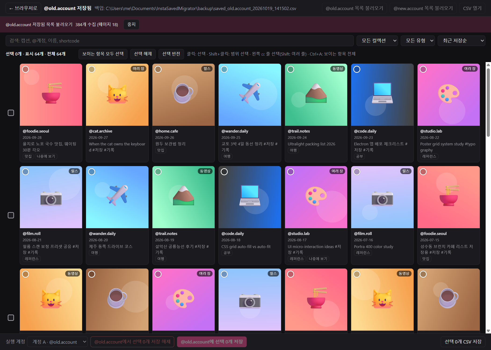

## 🛡 Speed, safety, and auto-stop

Instagram limits how fast an account can perform actions. This app is deliberately slow by default, and every value can be changed under **속도 / 안전 설정** (_Speed / safety_):

| Setting | Default | Meaning |
|---|---|---|
| Delay between actions | **15–40 s** (random) | Wait time after each successful save or unsave |
| Break every N actions | **40** | After N actions, take a longer break |
| Break length | **10 min** (±20%) | |
| Max per run | **200** | The run stops by itself after this many actions. Run the same CSV again later to continue |
| Oldest first (save) | **on** | Keeps the original order on the target account |
| Mode | **Click** | See below |

**It stops automatically when:**
- Instagram shows **"Try Again Later" / "Action Blocked"** → wait a few hours to a day and increase the delays
- the session is **logged out**, or a **checkpoint / identity check** appears → resolve it in the right-hand browser, then run again
- **3 failures in a row** → usually the page layout changed. Check the log

**Rough timing with the defaults:** about 27 s per action plus breaks, which is roughly 100 posts an hour. A few hundred per session is a sensible pace.

### Click mode vs API mode

| | **Click mode** (default, recommended) | **API mode** (experimental) |
|---|---|---|
| What it does | Opens `instagram.com/p/<code>/`, finds the bookmark button, and sends a real mouse click | Sends the save/unsave request directly without opening the post |
| Speed | Slower (page load + delay) | Faster |
| Robustness | Same thing a person does | Depends on a request address that Instagram can change |
| How it learns | — | Instagram's web app sends save/unsave as a **GraphQL mutation** (e.g. `usePolarisSaveMediaUnsaveMutation`). The first post is handled by a click, the app records that request's format, and the following posts reuse it with only the post id swapped |
| Fallback | — | If the request is rejected (for example an expired token), that post is clicked instead, the format is learned again, and the run returns to API mode. After 3 API failures in one run it stays in click mode |

## 🧩 How it works

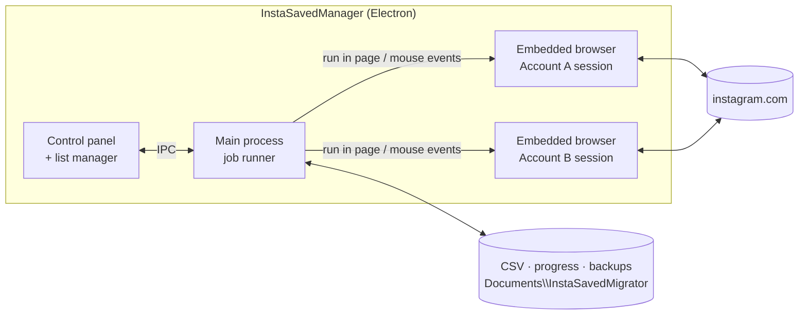

- **Isolated sessions.** Each account tab is a separate Chromium session that persists on disk (`persist:` partitions), so both logins survive restarts.
- **Requests from inside the page.** Listing saved posts calls Instagram's web endpoints with `fetch` **inside the logged-in page**. The app never reads or stores your cookies or password.
- **Real clicks.** Click mode scrolls the bookmark button into view and sends native mouse events (`webContents.sendInputEvent`), then checks that the icon changed (Save ↔ Remove) before counting the post as done.
- **State machine per post.** Each post resolves to a final status. Progress is written after every item, so a crash or a stop never repeats work.

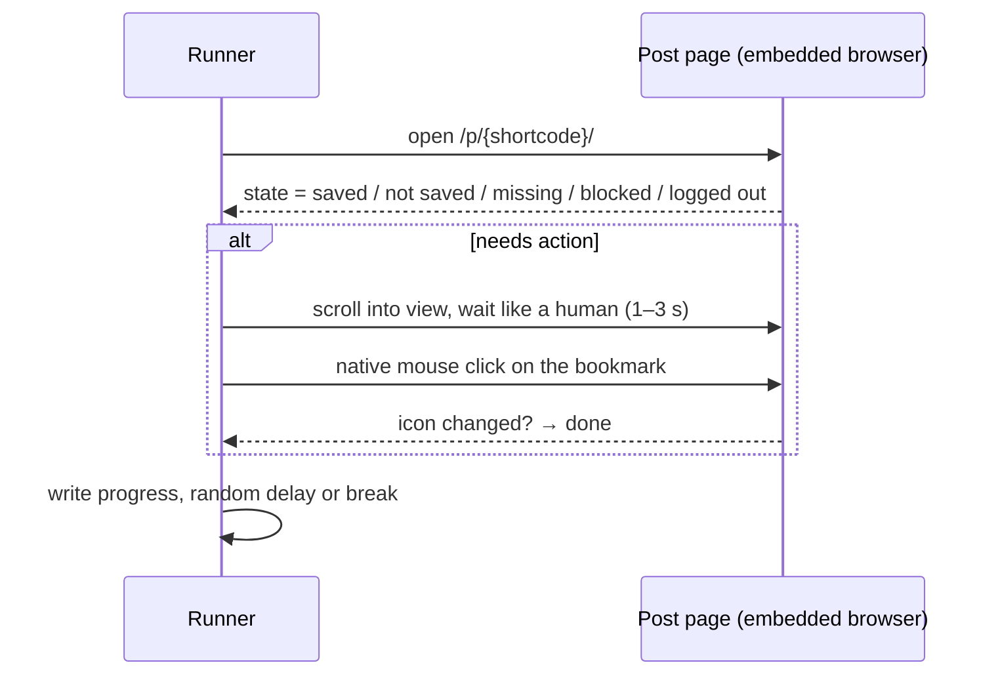

## 📁 Files the app creates

| Location | What |
|---|---|
| `Documents\InstaSavedMigrator\backup\saved_<account>_<time>.csv` | Written **every time** a list is loaded. This is your safety net |
| `Documents\InstaSavedMigrator\jobs\<save\|unsave>_<account>_<time>.csv` | The list of posts for a selection run. Load it again to resume |
| `<csv>.restore-progress.json` / `<csv>.unsave-progress.json` | Per-post progress used for resuming |
| `<csv>.restore-result.csv` / `<csv>.unsave-result.csv` | Final report with status, message, and time for each post |
| `%APPDATA%\insta-saved-migrator\` | Browser sessions (your logins) and remembered API addresses. **Log out** in the app to clear a session |

### CSV columns

| Column | Example | Notes |
|---|---|---|
| `saved_index` | `0` | 0 = most recently saved |
| `shortcode` | `C7xQ2mLp9aK` | The id in `instagram.com/p/<shortcode>/`. This column alone is enough to restore |
| `url` | `https://www.instagram.com/p/…/` | `/reel/…` for reels |
| `media_pk` | `3400…` | Numeric media id |
| `username`, `full_name` | `studio.lab`, `Studio Lab` | Author |
| `media_type`, `product_type` | `carousel`, `clips` | photo / video / carousel; `clips` = reel |
| `taken_at` | `2026-09-24T00:00:00.000Z` | Posted time (UTC) |
| `caption` | … | Full caption |
| `collection_ids`, `collection_names` | `…`, `여행\|레퍼런스` | `\|`-separated |
| `thumbnail_url` | … | Used by the list manager. Instagram image links expire after a while |

> A plain text file with **one post URL per line** also works as input.

## 🔒 Privacy

- **No servers, no telemetry, no analytics.** The app talks only to instagram.com, from the embedded browser, as you.
- **Your password never touches app code.** You type it into Instagram's own login page. The app only checks whether a session cookie exists to show "logged in".
- **Everything stays on your PC:** sessions in `%APPDATA%`, CSVs in `Documents`.
- The code is small and readable. Start with [`src/main.js`](src/main.js), [`src/runner.js`](src/runner.js), and [`src/saved.js`](src/saved.js).

## 🛠 Build from source

```bash
git clone https://github.com/UniverseMaker/Instagram-Saved-Transfer-and-Remove-Manager.git
cd Instagram-Saved-Transfer-and-Remove-Manager
npm install
npm start            # run in development
npm run dist         # build dist/*-portable.exe and dist/*-setup.exe
npm run screenshots  # regenerate the README images from demo data
```

If `npm install` reports that Electron's install script was not run (npm `allow-scripts`), run `npm approve-scripts electron`, or run `node node_modules/electron/install.js` once.

<details>
<summary><b>Project structure</b></summary>

```
src/
  main.js        Electron main: windows, sessions, IPC, jobs
  preload.js     Safe bridge between the UI and the main process
  ig.js          Runs fetch inside the Instagram page, delays, URL helpers
  saved.js       Saved-list paging → rows → CSV
  runner.js      Save/unsave runner: click & API modes, resume, auto-stop
  csv.js         Small CSV reader/writer (quotes, line breaks, BOM)
  ui/            Control panel + list manager (HTML/CSS/JS)
scripts/screenshots/  Demo-data screenshot generator for this README
build/           App icon
```
</details>

## ❓ Troubleshooting & FAQ

<details>
<summary><b>"저장 버튼을 찾지 못함" (<i>save button not found</i>)</b></summary>

The app finds the bookmark by its accessible label: `저장/삭제` (Korean), `Save/Remove` (English), or `保存/削除` (Japanese). If your Instagram UI uses another language, or Instagram renamed the button, the log line lists the labels it did find. Please open an issue with that line.
</details>

<details>
<summary><b>It stopped with "blocked" / "Try Again Later"</b></summary>

Instagram has limited the account for now. Wait several hours to a day, then increase the delays and lower **Max per run**. Progress is kept, so the next run continues where this one stopped.
</details>

<details>
<summary><b>API mode logs "API 요청 실패" or HTTP 404</b></summary>

That's expected on the first post or after a token expires. The post is handled by a click, the request format is learned again (`🔎 API 방식 학습: GraphQL …` in the log), and API mode resumes (`↩ … API 모드에 복귀`). If the log shows `변수에서 게시물 ID를 찾지 못해 학습 불가`, Instagram changed the request shape. Please open an issue with that line.
</details>

<details>
<summary><b>Many posts end as <code>not_found</code></b></summary>

The post was deleted, the author's account is private (and the target account doesn't follow it), or the author blocked the account. These can't be saved and are skipped.
</details>

<details>
<summary><b>Is the order preserved?</b></summary>

Yes, when **오래된 것부터** (_Oldest first_) is on (the default), posts are saved oldest first, so the newest ends up on top just like the original account.
</details>

<details>
<summary><b>Are collections recreated on the target account?</b></summary>

Not yet. Collection names are recorded in the CSV, and you can filter by them in the list manager, but restore saves posts to the main Saved list only. See the roadmap.
</details>

<details>
<summary><b>Does it work on macOS / Linux?</b></summary>

The code is cross-platform Electron, but only Windows builds are published. `npm start` should work on other systems. Packaging for them is on the roadmap.
</details>

## 🗺 Limitations & roadmap

- [x] Export · list manager · selective/all unsave · migration · resume · auto-stop
- [x] Row selection, range selection, filters
- [ ] Recreate **collections** on the target account
- [ ] **Move** mode: save to B and unsave from A in one pass
- [ ] English UI
- [ ] macOS / Linux builds, code-signed Windows build

Ideas and bug reports are welcome in [Issues](https://github.com/UniverseMaker/Instagram-Saved-Transfer-and-Remove-Manager/issues).

## ⚠ Disclaimer

This is an independent open-source project. It is **not affiliated with, endorsed by, or sponsored by Instagram or Meta**. "Instagram" is a trademark of its owner.

Automating actions may go against Instagram's Terms of Use and can lead to temporary limits on your account. The app only acts on **your own** accounts, at a deliberately slow pace, and stops when Instagram pushes back. Even so, **you use it at your own risk**. Keep the backup CSVs.

## 📄 License

[MIT](LICENSE) © 2026 UniverseMaker


<br/>

---

# 한국어

## 목차

- [목표](#-목표)
- [왜 필요한가](#-왜-필요한가)
- [주요 기능](#-주요-기능)
- [다운로드 · 설치](#-다운로드--설치)
- [빠른 시작](#-빠른-시작)
- [목록 관리 화면](#-목록-관리-화면)
- [속도 · 안전 · 자동 정지](#-속도--안전--자동-정지)
- [동작 원리](#-동작-원리)
- [앱이 만드는 파일](#-앱이-만드는-파일)
- [개인정보](#-개인정보)
- [소스에서 빌드](#-소스에서-빌드)
- [문제 해결 · FAQ](#-문제-해결--faq)
- [한계 · 로드맵](#-한계--로드맵)
- [면책 조항](#-면책-조항)
- **[🇺🇸 Read in English →](#english)**

---

## 🎯 목표

인스타그램 **저장됨**은 어느새 나만의 자료실이 됩니다. 맛집, 여행 동선, 디자인 레퍼런스, 공부 자료가 몇 년에 걸쳐 수백, 수천 개씩 쌓입니다.

이 프로젝트의 목표는 그 자료실을 **내 손으로 다룰 수 있게** 하는 것입니다.

1. **소유하기.** 전부 CSV로 내보내 보관하고, 검색하고, 엑셀로 열어볼 수 있습니다.
2. **옮기기.** 다른 계정에 같은 저장 목록을 원래 순서 그대로 다시 만듭니다.
3. **정리하기.** 고른 것만, 혹은 전부 저장 해제합니다. 해제 전에는 백업을 먼저 만듭니다.

앱이 하는 일은 사람이 손으로 하는 것(게시물 열기 → 책갈피 누르기)과 같습니다. 다만 지치지 않고, 진행 상황을 기록하고, 중단돼도 이어서 하고, 속도를 스스로 조절합니다.

## 🤔 왜 필요한가

인스타그램에는 아래 기능이 **기본으로 없습니다**.

| 상황 | 이 도구 없이 | 이 도구로 |
|---|---|---|
| 새 계정으로 이사 (아이디 변경, 개인·업무 계정 분리, 계정 분실) | 게시물을 하나하나 열어 다시 저장 | CSV를 불러와 **이 계정에 저장** 한 번. 멈춰도 이어서 진행 |
| 쌓인 저장 수천 개 정리 | 앱에서 하나씩 해제 | 필터 → 줄·범위 선택 → **선택 항목 저장 해제**, 또는 **전체 저장 해제…** |
| 저장한 목록을 따로 보관 | "내 정보 다운로드"는 보관용 압축 파일일 뿐, 계정에 다시 넣을 수 없음 | 깔끔한 CSV(shortcode, URL, 작성자, 캡션, 컬렉션)이고, 그대로 **복원**에도 사용 |
| 일부만 골라서 옮기기 | 불가능 | 썸네일로 보면서 골라 다른 계정에 저장 |
| 위 작업을 안전하게 | 빨리 누르다 "잠시 후 다시 시도" 제한에 걸리기 쉬움 | 무작위 간격, 주기적 휴식, 1회 최대 개수, 제한 감지 시 자동 정지 |

## ✨ 주요 기능

### 두 계정을 나란히
**계정 A / 계정 B** 탭은 각각 분리된 브라우저 세션이라 두 계정에 동시에 로그인해 둘 수 있습니다. 모든 작업은 선택된 탭의 계정에서 실행됩니다. 로그인은 앱 안의 인스타그램 공식 로그인 페이지에서 하므로 2단계 인증이나 본인 확인도 평소처럼 처리됩니다.

### CSV 내보내기
버튼 하나로 저장됨 전체를 페이지 단위로 받아 UTF-8 CSV로 저장합니다. 엑셀에서 한글이 깨지지 않습니다. 페이지마다 파일을 갱신하므로 중간에 끊겨도 받은 데까지는 남고, 컬렉션 이름도 함께 기록됩니다.

### 목록 관리
저장 게시물을 창 전체에 썸네일 그리드로 보여주고 검색, 필터, 정렬, 여러 선택 방법을 제공합니다. [아래에서 자세히](#-목록-관리-화면) 설명합니다.

### 저장 해제: 골라서 또는 전부
- **골라서:** 목록 관리에서 선택한 게시물을 로그인된 아무 계정에서나 해제합니다.
- **전체 저장 해제…:** 전체 목록을 불러와 **백업 CSV를 먼저 저장**하고, 개수를 보여준 뒤 한 번 더 확인받고 시작합니다.

### 다른 계정으로 복원 · 이전
대상 계정에서 게시물을 하나씩 열어 **저장**을 누릅니다. 기본값이 **오래된 것부터** 저장이라 대상 계정에도 원래 순서대로 쌓입니다.

### 오래 걸리는 작업을 위한 설계
- **이어하기:** 진행 상황이 CSV 옆에 저장됩니다. 같은 CSV로 다시 실행하면 끝난 항목은 건너뜁니다.
- **결과 보고서:** `*-result.csv`에 게시물별 상태(`saved`, `already_saved`, `removed`, `not_saved`, `not_found`, `failed` 등)가 남습니다.
- **자동 정지:** 활동 제한, 로그아웃, 본인 확인, 연속 3회 실패가 감지되면 멈춥니다.

<table>
<tr>
<td width="33%" align="center"><br/><sub><b>복원 진행 중</b><br/>진행률, 처리 개수, 다음 작업까지 남은 시간</sub></td>
<td width="33%" align="center"><br/><sub><b>전체 저장 해제</b><br/>백업 먼저, 그다음 하나씩 해제</sub></td>
<td width="33%" align="center"><br/><sub><b>속도 / 안전 설정</b><br/>"잠시 후 다시 시도" 감지 시 자동 정지</sub></td>
</tr>
</table>

## ⬇ 다운로드 · 설치

**[Releases](https://github.com/UniverseMaker/Instagram-Saved-Transfer-and-Remove-Manager/releases/latest)** 에서 최신 버전을 받으세요.

| 파일 | 이럴 때 |
|---|---|
| `InstaSavedManager-x.y.z-portable.exe` | 설치 없이 파일 하나로 쓰고 싶을 때. 더블클릭하면 바로 실행됩니다. 실행할 때마다 임시 폴더에 풀어서 뜨기까지 몇 초 걸립니다 |
| `InstaSavedManager-x.y.z-setup.exe` | 자주 쓸 때. 일반 프로그램처럼 설치되고 시작 메뉴·바탕화면 바로가기가 생기며 더 빨리 뜹니다 |

> **Windows SmartScreen:** 코드 서명이 없는 실행 파일이라 처음 실행할 때 "Windows의 PC 보호" 창이 뜰 수 있습니다. **추가 정보 → 실행**을 누르면 됩니다. 이 소스로 [직접 빌드](#-소스에서-빌드)해도 됩니다.

요구 사항은 Windows 10 / 11 (x64)뿐입니다. 브라우저가 내장돼 있어 따로 설치할 것이 없습니다.

## 🚀 빠른 시작

### 1. 저장됨 백업 (내보내기)

1. **계정 A** 탭을 선택하고 오른쪽 인스타그램 화면에서 로그인합니다.
2. **CSV로 내보내기**를 누르고 저장 위치를 고릅니다.
3. 로그에 `✅ 내보내기 완료`가 뜨면 끝입니다.

### 2. 계정 A의 저장을 계정 B로 옮기기

1. 위처럼 **계정 A**에서 내보냅니다. 목록 관리를 열어도 백업 CSV가 자동으로 만들어집니다.
2. **계정 B** 탭을 선택하고 두 번째 계정으로 로그인합니다.
3. **CSV로 실행**에서 **CSV 불러오기**로 파일을 고릅니다.
4. **이 계정에 저장 (복원)**을 누릅니다.
5. 켜두면 알아서 진행됩니다. 언제든 중지할 수 있고, 같은 CSV를 불러와 다시 누르면 멈춘 곳부터 이어갑니다.

> **일부만 옮기려면:** 계정 A에서 **목록 관리 열기** → 게시물 선택 → **실행 계정**을 계정 B로 변경 → **선택 항목 저장**.

### 3. 정리하기

- **일부만:** 목록 관리에서 필터를 걸고 선택한 뒤 **선택 항목 저장 해제**.
- **전부:** **전체 저장 해제…**. 지우기 전에 백업 CSV가 먼저 저장됩니다. 마음이 바뀌면 2번 방법으로 그 CSV를 복원하면 됩니다.

> 💡 **처음엔 작게 시험하세요.** 설정에서 **한 번 실행 최대**를 3~5로 줄여 한 번 돌려보고, 로그를 확인한 다음 늘리세요.

## 🗂 목록 관리 화면


| 동작 | 방법 |
|---|---|
| 하나 선택 | 카드 클릭 |
| 범위 선택 | 카드 하나를 클릭한 뒤 다른 카드를 **Shift+클릭** |
| **한 줄 전체 선택** | 줄 맨 왼쪽 **□** 클릭. 줄 전체가 선택되면 ✓, 일부만 선택되면 – 표시 |
| 여러 줄 선택 | 한 줄의 □를 누른 뒤 다른 줄의 □를 **Shift+클릭** |
| 보이는 항목 전체 | **Ctrl+A** 또는 **보이는 항목 모두 선택** |
| 반전 / 해제 | **선택 반전** / **선택 해제** |
| 게시물 열기 | 카드에 마우스를 올리면 나오는 **열기 ↗** → 내장 브라우저에서 열림 |
| 닫기 | **← 브라우저로** 또는 **Esc** |

한 줄에 들어가는 카드 수는 창 너비에 따라 달라집니다. 창 크기를 바꾸면 줄이 다시 계산되고 선택은 그대로 유지됩니다.


**검색 · 필터.** 검색어는 캡션, @작성자, 이름, shortcode에서 찾습니다. 필터는 컬렉션별(컬렉션 없음 포함)과 유형별(사진 / 여러 장 / 동영상 / 릴스)이 있습니다. 정렬은 최근·오래된 저장순, 게시일 최신·오래된순, 계정 이름순입니다.


**선택 항목 작업** (아래 막대)은 **실행 계정**으로 고른 계정에 적용됩니다.
- **선택 항목 저장 해제** (실행 전 확인 창)
- **선택 항목 저장**: 선택한 것을 다른 계정으로 옮길 때 씁니다
- **선택 항목 CSV 저장**

선택 작업은 매번 `문서\InstaSavedMigrator\jobs\…csv`로 저장되므로, 나중에 **CSV 불러오기**로 이어서 할 수 있습니다.


## 🛡 속도 · 안전 · 자동 정지

인스타그램은 계정이 일정 시간에 할 수 있는 동작 수를 제한합니다. 그래서 이 앱의 기본값은 일부러 느리고, 모든 값은 **속도 / 안전 설정**에서 바꿀 수 있습니다.

| 설정 | 기본값 | 의미 |
|---|---|---|
| 작업 간격 | **15~40초** (무작위) | 저장 또는 해제 한 번이 성공한 뒤 기다리는 시간 |
| N개마다 휴식 | **40** | N개 처리할 때마다 길게 쉬기 |
| 휴식 시간 | **10분** (±20%) | |
| 한 번 실행 최대 | **200** | 이만큼 처리하면 스스로 멈춤. 나중에 같은 CSV로 다시 실행하면 이어감 |
| 저장 시 오래된 것부터 | **켜짐** | 대상 계정에서도 원래 순서 유지 |
| 방식 | **클릭** | 아래 비교표 참고 |

**자동으로 멈추는 경우**
- **"잠시 후 다시 시도" / 활동 제한** → 몇 시간~하루 쉬고 간격을 늘리세요
- **로그아웃**되었거나 **본인 확인**이 뜸 → 오른쪽 브라우저에서 처리하고 다시 실행
- **연속 3회 실패** → 대개 화면 구조가 바뀐 것이니 로그를 확인하세요

**기본값 기준 소요 시간:** 한 건에 평균 약 27초에 휴식을 더하면 시간당 100개 안팎입니다. 한 번에 수백 개 정도가 무난합니다.

### 클릭 방식 vs API 방식

| | **클릭 방식** (기본, 권장) | **API 방식** (실험적) |
|---|---|---|
| 하는 일 | `instagram.com/p/<code>/`를 열고 책갈피 버튼을 찾아 실제 마우스 클릭 | 게시물을 열지 않고 저장/해제 요청을 바로 보냄 |
| 속도 | 느림 (페이지 로딩 + 간격) | 빠름 |
| 안정성 | 사람이 하는 것과 같음 | 인스타그램이 바꿀 수 있는 요청 주소에 의존 |
| 학습 방식 | — | 인스타그램 웹은 저장/해제를 **GraphQL mutation**(예: `usePolarisSaveMediaUnsaveMutation`)으로 보냅니다. 첫 게시물은 클릭으로 처리하면서 그 요청 형식을 기록하고, 이후 게시물은 게시물 ID만 바꿔 같은 요청을 보냅니다 |
| 대비책 | — | 요청이 거부되면(토큰 만료 등) 그 게시물은 클릭으로 처리하고 형식을 다시 학습한 뒤 API 방식으로 돌아옵니다. 한 번 실행에서 3번 실패하면 그 실행은 클릭 방식으로만 진행합니다 |

## 🧩 동작 원리

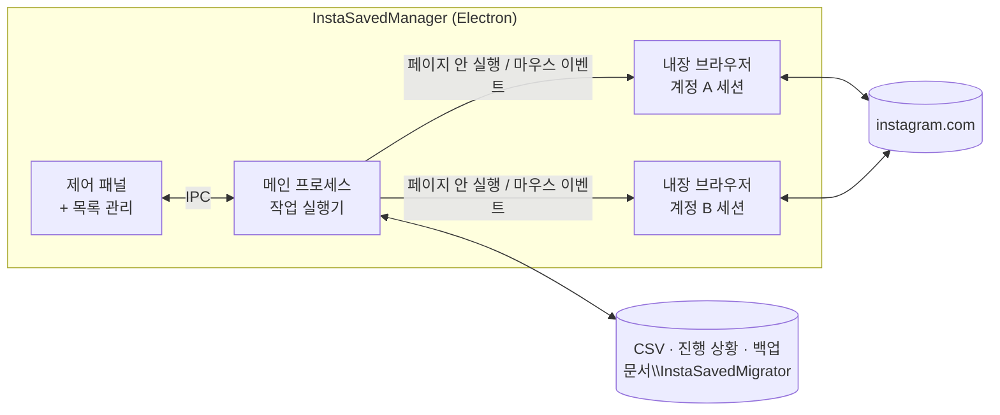

- **세션 분리.** 계정 탭마다 디스크에 저장되는 별도의 Chromium 세션(`persist:` 파티션)을 써서, 앱을 껐다 켜도 두 계정의 로그인이 유지됩니다.
- **페이지 안에서 요청.** 저장 목록 조회는 **로그인된 페이지 안에서** `fetch`로 인스타그램 웹 API를 호출합니다. 앱이 쿠키나 비밀번호를 읽거나 저장하지 않습니다.
- **실제 클릭.** 클릭 방식은 책갈피 버튼을 화면 가운데로 스크롤한 뒤 네이티브 마우스 이벤트(`webContents.sendInputEvent`)를 보냅니다. 아이콘이 바뀐 것(저장 ↔ 삭제)을 확인한 뒤에야 완료로 셉니다.
- **게시물별 상태 기록.** 각 게시물은 최종 상태로 끝나고, 한 건마다 진행 상황을 저장하므로 멈추거나 튕겨도 같은 작업을 반복하지 않습니다.

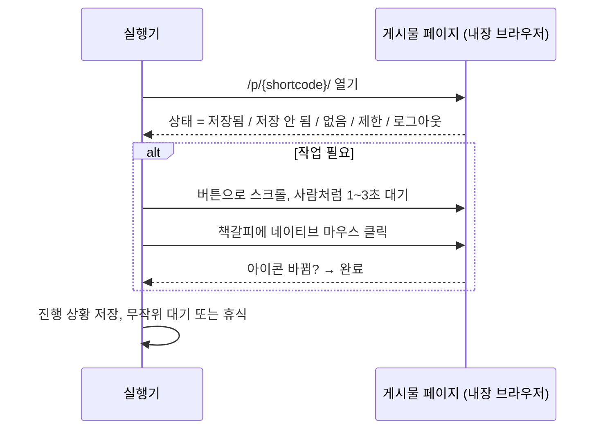

## 📁 앱이 만드는 파일

| 위치 | 내용 |
|---|---|
| `문서\InstaSavedMigrator\backup\saved_<계정>_<시각>.csv` | 목록을 불러올 **때마다** 자동 저장. 안전장치입니다 |
| `문서\InstaSavedMigrator\jobs\<save\|unsave>_<계정>_<시각>.csv` | 선택 작업 목록. 다시 불러오면 이어서 진행 |
| `<csv>.restore-progress.json` / `<csv>.unsave-progress.json` | 이어하기용 게시물별 진행 상황 |
| `<csv>.restore-result.csv` / `<csv>.unsave-result.csv` | 게시물별 상태·메시지·시각을 담은 최종 보고서 |
| `%APPDATA%\insta-saved-migrator\` | 브라우저 세션(로그인 정보)과 기억한 API 주소. 앱의 **로그아웃** 버튼으로 세션 삭제 |

### CSV 컬럼

| 컬럼 | 예시 | 설명 |
|---|---|---|
| `saved_index` | `0` | 0 = 가장 최근에 저장 |
| `shortcode` | `C7xQ2mLp9aK` | `instagram.com/p/<shortcode>/`의 id. 이 컬럼만 있어도 복원 가능 |
| `url` | `https://www.instagram.com/p/…/` | 릴스는 `/reel/…` |
| `media_pk` | `3400…` | 숫자 미디어 id |
| `username`, `full_name` | `studio.lab`, `Studio Lab` | 작성자 |
| `media_type`, `product_type` | `carousel`, `clips` | photo / video / carousel, `clips` = 릴스 |
| `taken_at` | `2026-09-24T00:00:00.000Z` | 게시 시각 (UTC) |
| `caption` | … | 캡션 전체 |
| `collection_ids`, `collection_names` | `…`, `여행\|레퍼런스` | `\|`로 구분 |
| `thumbnail_url` | … | 목록 관리 썸네일용. 인스타그램 이미지 주소는 시간이 지나면 만료됩니다 |

> **게시물 URL을 한 줄에 하나씩** 적은 텍스트 파일도 입력으로 쓸 수 있습니다.

## 🔒 개인정보

- **서버 · 수집 · 분석 없음.** 앱은 내장 브라우저에서 사용자 본인으로서 instagram.com과만 통신합니다.
- **비밀번호는 앱 코드에 닿지 않습니다.** 인스타그램 공식 로그인 페이지에 직접 입력합니다. 앱은 "로그인됨" 표시를 위해 세션 쿠키가 있는지만 확인합니다.
- **모든 데이터는 내 PC에만 있습니다:** 세션은 `%APPDATA%`, CSV는 `문서` 폴더.
- 코드가 작아서 직접 확인하기 쉽습니다. [`src/main.js`](src/main.js), [`src/runner.js`](src/runner.js), [`src/saved.js`](src/saved.js)부터 보세요.

## 🛠 소스에서 빌드

```bash
git clone https://github.com/UniverseMaker/Instagram-Saved-Transfer-and-Remove-Manager.git
cd Instagram-Saved-Transfer-and-Remove-Manager
npm install
npm start            # 개발 실행
npm run dist         # dist/*-portable.exe, dist/*-setup.exe 빌드
npm run screenshots  # 데모 데이터로 README 이미지 다시 생성
```

`npm install`에서 Electron 설치 스크립트가 실행되지 않았다는 경고(npm `allow-scripts`)가 나오면 `npm approve-scripts electron`을 실행하거나, `node node_modules/electron/install.js`를 한 번 실행하세요.

<details>
<summary><b>프로젝트 구조</b></summary>

```
src/
  main.js        Electron 메인: 창, 세션, IPC, 작업 관리
  preload.js     UI와 메인 프로세스 사이의 안전한 연결
  ig.js          인스타그램 페이지 안에서 fetch 실행, 대기, URL 도구
  saved.js       저장 목록 페이지 조회 → 행 → CSV
  runner.js      저장/해제 실행기: 클릭·API 방식, 이어하기, 자동 정지
  csv.js         작은 CSV 읽기/쓰기 (따옴표, 줄바꿈, BOM)
  ui/            제어 패널 + 목록 관리 (HTML/CSS/JS)
scripts/screenshots/  README용 데모 스크린샷 생성기
build/           앱 아이콘
```
</details>

## ❓ 문제 해결 · FAQ

<details>
<summary><b>"저장 버튼을 찾지 못함"</b></summary>

앱은 책갈피 버튼을 접근성 이름으로 찾습니다: `저장/삭제`(한국어), `Save/Remove`(영어), `保存/削除`(일본어). 인스타그램 UI가 다른 언어이거나 이름이 바뀌었다면, 로그 줄에 실제로 찾은 이름들이 표시됩니다. 그 줄을 이슈로 올려주세요.
</details>

<details>
<summary><b>"blocked" / "잠시 후 다시 시도"로 멈춤</b></summary>

인스타그램이 계정 활동을 잠시 제한한 상태입니다. 몇 시간~하루 쉬고, 간격을 늘리고 **한 번 실행 최대**를 줄여서 다시 실행하세요. 진행 상황은 남아 있어 멈춘 곳부터 이어갑니다.
</details>

<details>
<summary><b>API 방식에서 "API 요청 실패" 또는 HTTP 404</b></summary>

첫 게시물이거나 토큰이 만료된 경우 정상적인 동작입니다. 그 게시물은 클릭으로 처리되고 요청 형식을 다시 학습한 뒤(`🔎 API 방식 학습: GraphQL …`), API 방식으로 돌아옵니다(`↩ … API 모드에 복귀`). 로그에 `변수에서 게시물 ID를 찾지 못해 학습 불가`가 보이면 인스타그램이 요청 형식을 바꾼 것이니 그 줄을 이슈로 올려주세요.
</details>

<details>
<summary><b><code>not_found</code>가 많이 나옴</b></summary>

게시물이 삭제됐거나, 작성자 계정이 비공개인데 대상 계정이 팔로우하지 않거나, 작성자가 대상 계정을 차단한 경우입니다. 저장할 수 없으므로 건너뜁니다.
</details>

<details>
<summary><b>순서가 유지되나요?</b></summary>

네. **오래된 것부터**(기본값)가 켜져 있으면 오래된 게시물부터 저장하므로, 원래 계정처럼 최신 게시물이 맨 위에 옵니다.
</details>

<details>
<summary><b>컬렉션도 대상 계정에 다시 만들어지나요?</b></summary>

아직은 아닙니다. 컬렉션 이름은 CSV에 기록되고 목록 관리에서 컬렉션별로 필터할 수 있지만, 복원은 기본 저장됨에만 저장합니다. 로드맵을 참고하세요.
</details>

<details>
<summary><b>macOS / Linux에서도 되나요?</b></summary>

코드는 크로스플랫폼 Electron이지만 지금은 Windows 빌드만 배포합니다. 다른 OS에서도 `npm start`로 실행될 것으로 예상하며, 패키징은 로드맵에 있습니다.
</details>

## 🗺 한계 · 로드맵

- [x] 내보내기 · 목록 관리 · 선택/전체 저장 해제 · 계정 이전 · 이어하기 · 자동 정지
- [x] 줄 선택, 범위 선택, 필터
- [ ] 대상 계정에 **컬렉션** 다시 만들기
- [ ] **이동** 방식: B에 저장하면서 A에서 해제를 한 번에
- [ ] 영어 UI
- [ ] macOS / Linux 빌드, 코드 서명된 Windows 빌드

아이디어와 버그 제보는 [Issues](https://github.com/UniverseMaker/Instagram-Saved-Transfer-and-Remove-Manager/issues)에 남겨주세요.

## ⚠ 면책 조항

이 프로젝트는 독립적인 오픈소스이며 **Instagram 또는 Meta와 제휴하거나 승인·후원을 받지 않았습니다**. "Instagram"은 해당 소유자의 상표입니다.

동작을 자동화하는 것은 인스타그램 이용약관에 어긋날 수 있고, 계정 활동이 일시적으로 제한될 수 있습니다. 이 앱은 **본인 계정에서만**, 일부러 느린 속도로 동작하고, 인스타그램이 제한하면 멈춥니다. 그래도 **사용에 따른 책임은 사용자에게 있습니다.** 백업 CSV는 꼭 보관하세요.

## 📄 라이선스

[MIT](LICENSE) © 2026 UniverseMaker
